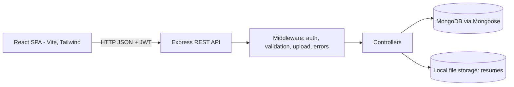
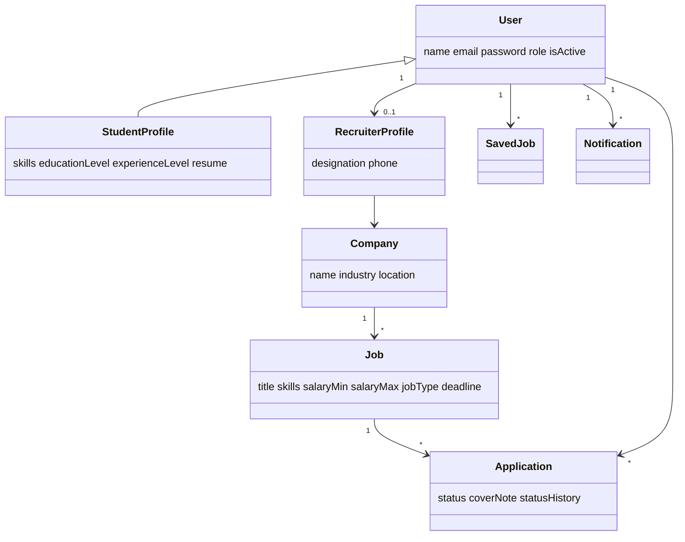
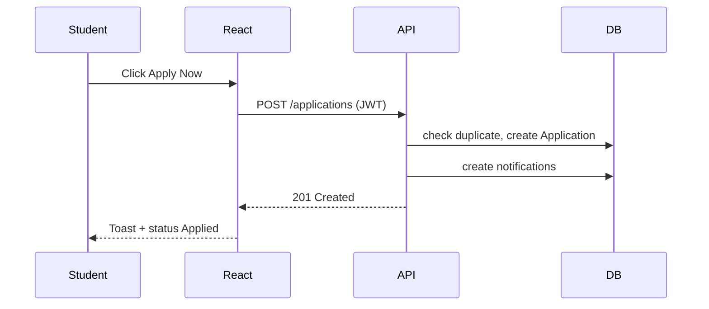
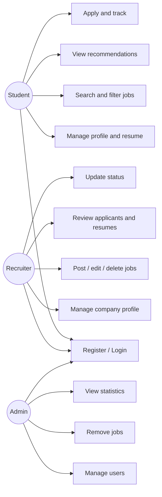
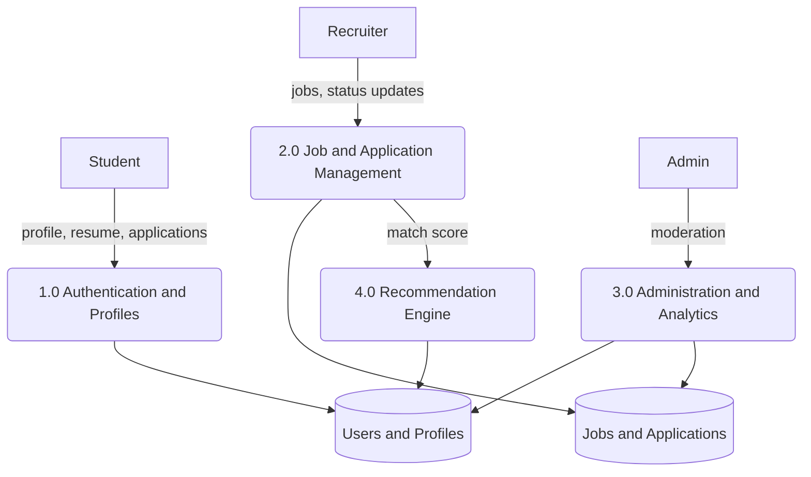
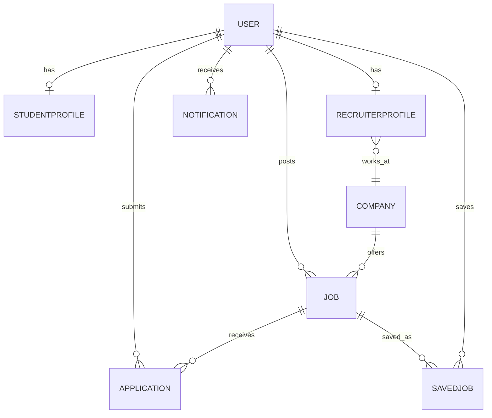

# SMART JOB PORTAL
### An Intelligent Platform for Job Search, Recruitment and Application Management

---
## 1. Cover Page
**Project Report** submitted in partial fulfilment of the requirements for the award of the degree of **Bachelor of Technology in Computer Science and Engineering**

| | |
|---|---|
| Student name | [STUDENT NAME] |
| Registration number | [REGISTRATION NUMBER] |
| Department | [DEPARTMENT] |
| College | [COLLEGE NAME] |
| Guide | [GUIDE NAME] |
| Academic year | [ACADEMIC YEAR] |

## 2. Certificate
This is to certify that the project entitled **"Smart Job Portal"** is a bona fide work carried out by **[STUDENT NAME]** (Reg. No. [REGISTRATION NUMBER]) in the Department of [DEPARTMENT], [COLLEGE NAME], during the academic year [ACADEMIC YEAR], under my guidance.

Guide: [GUIDE NAME] &nbsp;&nbsp;&nbsp; Head of Department: [HOD NAME] &nbsp;&nbsp;&nbsp; External Examiner: ____________

## 3. Declaration
I, [STUDENT NAME], hereby declare that this project report is my own work, carried out under the guidance of [GUIDE NAME], and has not been submitted to any other university or institution for any degree.

Place: ________ &nbsp;&nbsp; Date: ________ &nbsp;&nbsp; Signature: ________

## 4. Acknowledgement
I express my sincere gratitude to my guide [GUIDE NAME], the Head of the Department, the faculty of [DEPARTMENT], the management of [COLLEGE NAME], and my family and friends for their guidance and support throughout this project.

## 5. Abstract
Smart Job Portal is a web-based recruitment platform that connects students, recruiters and administrators. Students create profiles, upload PDF resumes, search and filter jobs, receive skill-based recommendations and track applications. Recruiters create company profiles, post jobs, review applicants and update application status. Administrators manage users, jobs and applications and monitor platform statistics. The system is built with React, Node.js, Express and MongoDB, secured with JWT and bcrypt, and runs entirely on a local machine without paid services or API keys. A rule-based algorithm computes a match percentage from skill overlap, experience level and education level and explains the result by listing matching and missing skills.

**Keywords:** MERN stack, job portal, recommendation, JWT, MongoDB.

## 6. Table of Contents
1 Introduction · 2 Problem Statement · 3 Objectives · 4 Existing System · 5 Proposed System · 6 Feasibility Study · 7 Hardware Requirements · 8 Software Requirements · 9 System Architecture · 10 UML Diagrams · 11 Use Case Diagram · 12 Data Flow Diagram · 13 Database Design · 14 Module Descriptions · 15 Implementation · 16 Screenshots · 17 Testing · 18 Results · 19 Advantages · 20 Limitations · 21 Future Enhancements · 22 Conclusion · 23 References

## 7. Introduction
Finding a suitable job and hiring the right candidate are time-consuming activities. Students use several unconnected websites, while recruiters receive applications by email in unstructured form. A single platform that stores structured profiles, resumes, job postings and application history simplifies both sides. Smart Job Portal provides such a platform with explainable, skill-based job matching.

## 8. Problem Statement
Job seekers lack one place to search jobs, understand how well they fit and track the outcome of applications. Recruiters lack a structured way to filter applicants and communicate status. Existing generic portals often depend on paid services or provide no explanation of why a job is recommended.

## 9. Objectives
1. Build a role-based platform for students, recruiters and administrators.
2. Provide secure registration, login and authorization.
3. Provide job search with advanced filters.
4. Recommend jobs using a transparent rule-based skill-matching algorithm.
5. Manage resumes and the complete application workflow with status tracking.
6. Provide dashboards with real data and analytics.
7. Run completely locally without paid APIs or cloud services.

## 10. Existing System
Manual applications through email or paper, general-purpose job boards with limited per-user explanation, spreadsheets for tracking applicants, and campus placement records kept in separate files. Drawbacks: duplicated effort, no central status tracking, poor filtering and no skill-gap feedback.

## 11. Proposed System
A MERN web application with three role-specific workspaces. Students get profile management, resume upload, recommendations and status tracking. Recruiters get posting, applicant filtering, resume download and status updates. Administrators get moderation and analytics. Notifications keep users informed of events.

## 12. Feasibility Study
- **Technical:** Uses mature open-source technologies (React, Node.js, MongoDB) that run on an ordinary laptop.
- **Economic:** No licence fees, paid APIs or hosting required for the local version.
- **Operational:** Simple role-based interfaces require little training.
- **Schedule:** Modular design allows incremental development and testing.

## 13. Hardware Requirements
Processor: dual-core 2 GHz or better · RAM: 8 GB recommended (4 GB minimum) · Storage: 2 GB free · Display: 1366x768 or higher.

## 14. Software Requirements
Windows 10/11 · Node.js 18+ · npm · MongoDB Community Edition · Visual Studio Code · Git · Modern browser (Chrome, Edge, Firefox) · Postman (optional).

## 15. System Architecture

Three tiers: presentation (React), application (Express), data (MongoDB and local disk).

## 16. UML Diagrams
### 16.1 Class diagram (simplified)

### 16.2 Sequence: apply for a job

## 17. Use Case Diagram

## 18. Data Flow Diagram
**Level 0:** Student, Recruiter and Admin exchange requests/responses with the *Smart Job Portal* process, which reads and writes the *MongoDB* data store and the *resume file store*.

## 19. Database Design

Key indexes: `User.email` (unique), `Job.title/skills/location/jobType/experienceLevel/deadline`, `Application(job, student)` (unique), `SavedJob(student, job)` (unique), `Notification.user`.

## 20. Module Descriptions
1. **Authentication:** registration, login, JWT, password change, role guards.
2. **Student:** profile, skills, education, experience, resume, saved jobs, applications, notifications.
3. **Recruiter:** company profile, job CRUD, applicant search/filter, resume download, status updates.
4. **Admin:** user, job and application management, statistics, recent activity.
5. **Job search and recommendation:** filters and the weighted matching algorithm.
6. **Application management:** duplicate prevention, status workflow, history.
7. **Dashboards:** aggregation-based analytics rendered with Recharts.

## 21. Implementation
- **Frontend:** React 18 with Vite; React Router for role-based routes; Context API for authentication; Axios with a JWT interceptor; Tailwind CSS design system with dark mode; Recharts; React Hot Toast.
- **Backend:** Express routes grouped under `/api/*`; controllers hold business logic; middleware handles JWT, role checks, validation, uploads and errors; Mongoose models define schemas, indexes and relationships.
- **Recommendation algorithm:** `skillMatch = matchingRequired / totalRequired x 100`; `experienceFit` is 100 if the student level is at or above the job level, 50 if one level below, otherwise 0; `educationFit` is 100 if the education level meets the minimum; `match = 0.7 skill + 0.2 experience + 0.1 education`.
- **Security:** bcryptjs hashing, JWT expiry, server-side authorization, validation, upload restrictions and regex escaping.
- **Seeding:** `server/scripts/seed.js` upserts demo data and is repeatable.

## 22. Screenshots
*Insert real screenshots here after capturing them using `SCREENSHOT_GUIDE.md`.*
Figure 1: Landing page [INSERT] · Figure 2: Student dashboard [INSERT] · Figure 3: Recommendations [INSERT] · Figure 4: Recruiter applicants [INSERT] · Figure 5: Admin dashboard [INSERT]

## 23. Testing
Fill the Result column yourself after running each test. Do not record results that were not observed.

| ID | Test | Expected | Result |
|---|---|---|---|
| T1 | Student registration | Account created and redirected to student dashboard | [ ] |
| T2 | Recruiter registration | Account and company created | [ ] |
| T3 | Duplicate email | Error shown, no second account | [ ] |
| T4 | Login with wrong password | "Incorrect email or password" | [ ] |
| T5 | Logout | Session cleared, protected pages redirect to login | [ ] |
| T6 | Student opens /recruiter | Redirected to /student | [ ] |
| T7 | Create / edit / delete job | Changes visible in Manage Jobs | [ ] |
| T8 | Search and filters | Results match criteria | [ ] |
| T9 | Recommendations | Match %, matching and missing skills shown | [ ] |
| T10 | Apply for a job | Appears in My Applications | [ ] |
| T11 | Apply twice | Blocked with message | [ ] |
| T12 | Save / remove saved job | Saved Jobs list updates | [ ] |
| T13 | Upload non-PDF or >2 MB | Rejected with message | [ ] |
| T14 | Upload and download resume | File downloads | [ ] |
| T15 | Recruiter downloads applicant resume | File downloads | [ ] |
| T16 | Update application status | Student sees new status and notification | [ ] |
| T17 | Admin deactivates / deletes user | User cannot log in / data removed | [ ] |
| T18 | Admin removes job | Job and applications removed, recruiter notified | [ ] |

## 24. Results
[Write the observed outcomes after executing the tests above: for example how many test cases passed, response behaviour and usability observations.]

## 25. Advantages
Single platform for three roles; explainable matching; local, free and private; structured applications; real analytics; responsive UI with dark mode; modular, maintainable code.

## 26. Limitations
Rule-based matching only (no semantic understanding); local file storage; no email/SMS delivery; no real-time updates; no automated test suite yet; single-server design.

## 27. Future Enhancements
Resume parsing, email and SMS notifications, interview calendar, refresh tokens and password reset, real-time chat, automated unit/integration tests, cloud deployment with managed storage.

## 28. Conclusion
Smart Job Portal demonstrates a complete, secure, locally runnable recruitment system that reduces effort for students and recruiters and gives administrators visibility. The explainable recommendation approach helps students understand and close their skill gaps.

## 29. References
1. MongoDB Documentation, https://www.mongodb.com/docs/
2. Express.js Guide, https://expressjs.com/
3. React Documentation, https://react.dev/
4. Node.js Documentation, https://nodejs.org/docs/
5. Mongoose Documentation, https://mongoosejs.com/docs/
6. Tailwind CSS Documentation, https://tailwindcss.com/docs
7. JSON Web Tokens, https://jwt.io/introduction
8. Recharts, https://recharts.org/
